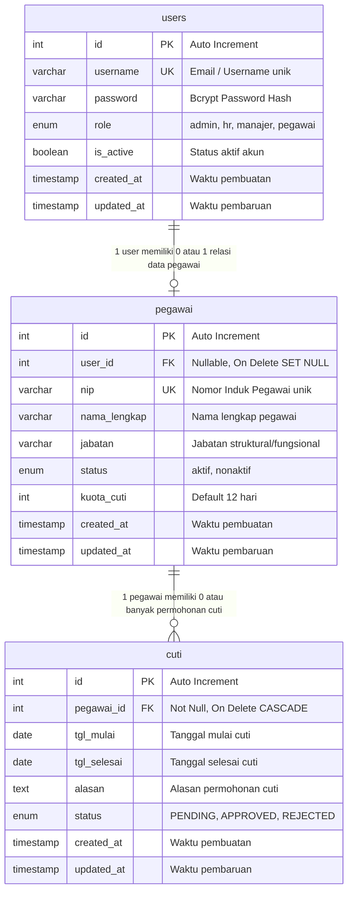

# DATA DICTIONARY
## Sistem Informasi Kepegawaian & Pelatihan PT INIX
### Engine Basis Data: MySQL 8.0 InnoDB (Charset: UTF-8 Unicode `utf8mb4`)

Dokumen kamus data ini disusun berdasarkan artefak skema DDL `database/schema.sql` dan inisialisasi data `database/seed.php`.

---

### 1. Diagram Relasi Entitas (Entity-Relationship Diagram)

---

### 2. Kamus Tabel `users`

Menyimpan data akun kredensial dan peran otorisasi pengguna sistem.

| Nama Kolom | Tipe Data | Nullable | Default | Kunci / Indeks | Deskripsi & Aturan Bisnis |
|---|---|---|---|---|---|
| `id` | `INT` | No | Auto Increment | **PK** | Identifier unik primary key akun pengguna. |
| `username` | `VARCHAR(100)` | No | None | **UNIQUE** | Alamat email unik untuk autentikasi sistem. |
| `password` | `VARCHAR(255)` | No | None | None | Hash password terenkripsi via `password_hash($pwd, PASSWORD_DEFAULT)` (Bcrypt). |
| `role` | `ENUM('admin','hr','manajer','pegawai')` | No | `'pegawai'` | None | Peran otorisasi pengguna dalam RBAC sistem. |
| `is_active` | `BOOLEAN` | Yes | `TRUE` | None | Flag status keaktifan akun. Akun bernilai `FALSE` ditolak saat proses login. |
| `created_at` | `TIMESTAMP` | Yes | `CURRENT_TIMESTAMP` | None | Waktu pencatatan data pertama kali. |
| `updated_at` | `TIMESTAMP` | Yes | `CURRENT_TIMESTAMP ON UPDATE CURRENT_TIMESTAMP` | None | Waktu mutasi data akun terakhir kali. |

---

### 3. Kamus Tabel `pegawai`

Menyimpan master profil identitas personalia dan kuota cuti tahunan pegawai.

| Nama Kolom | Tipe Data | Nullable | Default | Kunci / Indeks | Deskripsi & Aturan Bisnis |
|---|---|---|---|---|---|
| `id` | `INT` | No | Auto Increment | **PK** | Identifier unik pegawai. |
| `user_id` | `INT` | Yes | `NULL` | **FK** | Relasi ke `users(id)`. Aturan referensial: `ON DELETE SET NULL`. Dapat bernilai null untuk pegawai tanpa akun login portal. |
| `nip` | `VARCHAR(50)` | No | None | **UNIQUE** | Nomor Induk Pegawai unik organisasi (contoh format: `NIP-2025-001`). |
| `nama_lengkap` | `VARCHAR(200)` | No | None | None | Nama lengkap personil pegawai. Wajib diisi saat create/update. |
| `jabatan` | `VARCHAR(100)` | No | None | None | Jabatan posisi kerja (misal: `Staff HR`, `AI Engineer`). |
| `status` | `ENUM('aktif','nonaktif')` | Yes | `'aktif'` | None | Status kepegawaian personil. |
| `kuota_cuti` | `INT` | No | `12` | None | Kuota cuti tahunan dasar pegawai (default 12 hari kalender per tahun berjalan). |
| `created_at` | `TIMESTAMP` | Yes | `CURRENT_TIMESTAMP` | None | Waktu pembuatan record pegawai. |
| `updated_at` | `TIMESTAMP` | Yes | `CURRENT_TIMESTAMP ON UPDATE CURRENT_TIMESTAMP` | None | Waktu pembaruan record pegawai. |

---

### 4. Kamus Tabel `cuti`

Menyimpan seluruh transaksi pengajuan cuti dan status persetujuannya.

| Nama Kolom | Tipe Data | Nullable | Default | Kunci / Indeks | Deskripsi & Aturan Bisnis |
|---|---|---|---|---|---|
| `id` | `INT` | No | Auto Increment | **PK** | Identifier unik pengajuan cuti. |
| `pegawai_id` | `INT` | No | None | **FK** | Relasi ke `pegawai(id)`. Aturan referensial: `ON DELETE CASCADE`. |
| `tgl_mulai` | `DATE` | No | None | None | Tanggal dimulainya periode cuti (format `YYYY-MM-DD`). |
| `tgl_selesai` | `DATE` | No | None | None | Tanggal berakhirnya periode cuti (format `YYYY-MM-DD`). Aturan: `tgl_selesai >= tgl_mulai`. |
| `alasan` | `TEXT` | No | None | None | Deskripsi / justifikasi pengajuan cuti. |
| `status` | `ENUM('PENDING','APPROVED','REJECTED')` | Yes | `'PENDING'` | None | Status alur kerja permohonan. Nilai default pengajuan baru adalah `'PENDING'`. |
| `created_at` | `TIMESTAMP` | Yes | `CURRENT_TIMESTAMP` | None | Waktu pengajuan cuti disubmit. |
| `updated_at` | `TIMESTAMP` | Yes | `CURRENT_TIMESTAMP ON UPDATE CURRENT_TIMESTAMP` | None | Waktu mutasi status persetujuan cuti. |
