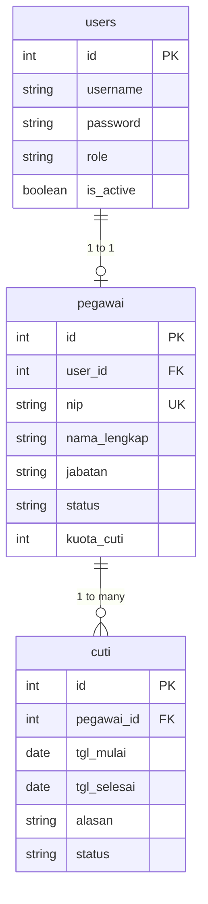

# SOFTWARE REQUIREMENTS SPECIFICATION (SRS) / FUNCTIONAL REQUIREMENTS DOCUMENT (FRD)
## Berdasarkan Standar ISO/IEC/IEEE 29148 & IEEE Std 830-1998

**Nama Proyek:** Sistem Informasi Kepegawaian PT INIX  
**Versi Dokumen:** 1.0  
**Tanggal:** 16 November 2026  
**Status:** Approved / Baseline for Testing  

---

## 1. Pendahuluan (Introduction)

### 1.1 Tujuan (Purpose)
Dokumen ini mendefinisikan spesifikasi kebutuhan fungsional (FRD) dan non-fungsional (SRS) untuk Aplikasi Kepegawaian internal PT INIX berbasis standar ISO/IEC/IEEE 29148 dan IEEE Std 830. Dokumen ini menjadi acuan utama tim pengembang, Quality Assurance (QA), dan stakeholder bisnis dalam verifikasi, validasi, perancangan test case, dan evaluasi risiko.

### 1.2 Cakupan Produk (Scope)
Sistem Informasi Kepegawaian PT INIX merupakan platform berbasis web untuk memfasilitasi operasional administrasi personalia inti, mencakup:
- Pengelolaan autentikasi akun dan Role-Based Access Control (RBAC).
- Pengelolaan master data pegawai (CRUD).
- Pengelolaan permohonan dan alur persetujuan cuti tahunan pegawai.

### 1.3 Definisi, Akronim, dan Singkatan
- **SRS:** Software Requirements Specification
- **FRD:** Functional Requirements Document
- **RBAC:** Role-Based Access Control
- **NIP:** Nomor Induk Pegawai
- **CRUD:** Create, Read, Update, Delete
- **P95:** 95th Percentile Response Time
- **OWASP:** Open Web Application Security Project
- **CSRF:** Cross-Site Request Forgery
- **PDO:** PHP Data Objects

### 1.4 Referensi
- IEEE Std 830-1998: *IEEE Recommended Practice for Software Requirements Specifications*.
- ISO/IEC/IEEE 29148:2018: *Systems and software engineering — Life cycle processes — Requirements engineering*.

---

## 2. Deskripsi Keseluruhan (Overall Description)

### 2.1 Arsitektur & Lingkungan Operasional
Sistem berarsitektur Monolitik Terpadu (Monolithic Web Application):
1. **Application & UI Layer:** PHP Native v8.5.x (Page-Controller & Minimalist View Rendering, Bootstrap/AdminLTE).
2. **Data Layer:** MySQL Database 8.0 via PDO (PHP Data Objects).
3. **Web Server:** Apache / Nginx (PHP-FPM) & Docker Compose.

### 2.2 Karakteristik Pengguna & Persona (RBAC)
| Role | Deskripsi Hak Akses |
|---|---|
| **Admin** | Akses penuh: Autentikasi, CRUD data pegawai, hapus data pegawai, kelola sistem. |
| **HR** | Akses administratif: Autentikasi, Read/Create/Update data pegawai, review data cuti. |
| **Manajer** | Akses pengawasan: Autentikasi, review dan Approval/Rejection cuti bawahan. |
| **Pegawai** | Akses mandiri: Autentikasi, melihat profil, cek kuota, pengajuan cuti tahunan. |

### 2.3 Batasan Desain & Implementasi
- Autentikasi berbasis Server-Side PHP Session terproteksi (`HttpOnly`, `SameSite=Lax`).
- Proteksi mutasi formulir menggunakan CSRF Token per-sesi.
- Penyimpanan password menggunakan hashing aman (`password_hash` bcrypt).
- Prepared statements PDO untuk seluruh interaksi basis data.
- Batas kuota cuti tahunan pegawai adalah default 12 hari kalender kerja per tahun berjalan.
- Deployment menggunakan Docker Compose.

---

## 3. Spesifikasi Kebutuhan Sistem (Specific Requirements)

### 3.1 Kebutuhan Fungsional (Functional Requirements)

| Req ID | Modul | Deskripsi Kebutuhan | Prioritas | Sumber / Kriteria Verifikasi |
|---|---|---|---|---|
| **FR-001** | Autentikasi | Pengguna dapat login menggunakan username dan password valid untuk membuat sesi kerja aktif. | High | POST `/login.php`, inisialisasi session dan redirect ke dashboard. |
| **FR-002** | Autentikasi | Sistem menampilkan pesan kesalahan/flash message saat kredensial salah atau akun non-aktif (`is_active = false`). | High | Flash notification error pada halaman login tanpa bocorkan eksistensi user. |
| **FR-003** | Data Pegawai | Pengguna role Admin dan HR dapat melihat daftar, menambah, mengubah, dan menghapus (khusus Admin) data profil pegawai. | High | Form & Handler pada `/pegawai.php`. |
| **FR-004** | Data Pegawai | Sistem melakukan validasi keunikan NIP (`nip` UNIQUE) dan mandatory check pada field Nama Lengkap dan Jabatan. | High | Flash error / validasi form jika NIP duplikat atau field wajib kosong. |
| **FR-005** | Pengajuan Cuti | Pegawai dapat mengajukan cuti dengan input tanggal mulai, tanggal selesai, dan alasan; sistem memvalidasi sisa kuota tahunan (maksimal 12 hari). | High | Form & Handler pada `/cuti.php`, validasi tanggal selesai ≥ mulai dan durasi ≤ kuota. |
| **FR-006** | Pengajuan Cuti | Manajer berwenang mengubah status pengajuan cuti pegawai menjadi `APPROVED` atau `REJECTED`. | High | Aksi persetujuan/penolakan pada `/cuti.php` (khusus role Manajer). |
| **FR-007** | Autentikasi | Sistem menerapkan Role-Based Access Control (RBAC) ketat pada tingkat akses halaman/modul dan verifikasi CSRF token pada setiap form POST. | High | HTTP 403 Forbidden atau redirect login jika akses tidak sah / token CSRF invalid. |

### 3.2 User Stories & Acceptance Criteria

#### US-001: Autentikasi Akun Pengguna
- **Pernyataan:** *As a User, I want to login with my credentials, so that I can access the system.*
- **Kriteria Penerimaan:**
  1. Validasi field kosong pada username dan password menampilkan pesan kesalahan.
  2. Kredensial valid menginisialisasi sesi PHP yang aman dan redirect ke halaman dashboard sesuai role.
  3. Kredensial tidak valid memunculkan notifikasi error yang informatif tanpa membocorkan eksistensi user.

#### US-002: Registrasi Pegawai Baru
- **Pernyataan:** *As an HR/Admin, I want to add a new employee, so that employee records are registered.*
- **Kriteria Penerimaan:**
  1. Field NIP wajib diisi dan harus unik di database.
  2. Field Nama Lengkap dan Jabatan wajib diisi.
  3. Data tersimpan di database MySQL (`pegawai`) dan otomatis muncul pada tabel daftar pegawai.

#### US-003: Pembaruan & Penghapusan Pegawai
- **Pernyataan:** *As an HR/Admin, I want to edit and delete employee records, so that data remains accurate.*
- **Kriteria Penerimaan:**
  1. Perubahan data pegawai terupdate secara langsung pada tampilan tabel pegawai.
  2. Terdapat modal konfirmasi verifikasi sebelum proses penghapusan data pegawai dijalankan.
  3. Operasi delete hanya diizinkan untuk role Admin dan diverifikasi dengan CSRF token.

#### US-004: Pengajuan Cuti Tahunan
- **Pernyataan:** *As a Pegawai, I want to submit a leave request, so that I can take my planned leave.*
- **Kriteria Penerimaan:**
  1. Tanggal selesai pengajuan harus bernilai lebih besar atau sama dengan tanggal mulai (`tgl_selesai >= tgl_mulai`).
  2. Durasi pengajuan cuti tidak boleh melebihi sisa `kuota_cuti` tahunan berjalan (default 12 hari).
  3. Status awal pengajuan cuti yang baru dibuat bernilai default `PENDING`.

#### US-005: Persetujuan Pengajuan Cuti
- **Pernyataan:** *As a Manajer, I want to approve or reject leave requests, so that leave status is updated.*
- **Kriteria Penerimaan:**
  1. Manajer dapat memilih tindakan `Approve` atau `Reject` pada pengajuan cuti berstatus `PENDING`.
  2. Status cuti terupdate menjadi `APPROVED` atau `REJECTED` dan kuota cuti pegawai berkurang otomatis jika disetujui.

---

## 4. Kebutuhan Non-Fungsional (Non-Functional Requirements)

| Req ID | Kategori | Deskripsi Kebutuhan | Standar / Metrik Keberhasilan |
|---|---|---|---|
| **NFR-001** | Performance | Latensi respon halaman server-side rendering harus cepat di bawah beban normal. | Response time ≤ 500ms pada persentil P95 dengan beban 50 concurrent users (pengujian via k6 / ApacheBench). |
| **NFR-002** | Security | Form input dan query database harus kebal terhadap ancaman injeksi dan scripting berbahaya. | Bebas dari celah OWASP Top 10 (khususnya SQL Injection via PDO Prepared Statements, XSS via escaping output, dan CSRF protection). |
| **NFR-003** | Compatibility | Tampilan antarmuka template Admin LTE / Bootstrap konsisten dan responsif pada berbagai peramban modern. | Lolos uji cross-browser (Google Chrome, Microsoft Edge, Mozilla Firefox versi stabil terbaru). |
| **NFR-004** | Security | Data kredensial pengguna dan sesi login tersimpan secara aman. | Password di-hash menggunakan algoritma aman (`password_hash` bcrypt); session ID terlindungi (`HttpOnly`, `SameSite=Lax`, regeneration per login). |

---

## 5. Model Data & Skema Database

### 5.1 Diagram Relasi Entitas (ERD)

---

## 6. Struktur Antarmuka & Modul Aplikasi (Page-Controller Monolithic)

| Modul File | Metode HTTP | Deskripsi Alur & Aksi | Hak Akses (RBAC) |
|---|---|---|---|
| `login.php` | `GET` | Render form login pengguna | Public |
| `login.php` | `POST` | Validasi kredensial, set session login, redirect dashboard | Public |
| `logout.php` | `POST` / `GET` | Hapus session login dan redirect ke login page | Authenticated |
| `index.php` | `GET` | Dashboard utama, ringkasan statistik & shortcut modul | Authenticated (Semua Role) |
| `pegawai.php` | `GET` | Daftar seluruh pegawai (tabel) & form tambah/edit modal | HR, Admin |
| `pegawai.php` | `POST` | Handler tambah (`action=create`) & ubah (`action=update`) pegawai | HR, Admin |
| `pegawai.php` | `POST` | Handler hapus pegawai (`action=delete`) | Admin |
| `cuti.php` | `GET` | Riwayat & daftar pengajuan cuti, info sisa kuota cuti | Authenticated (Semua Role) |
| `cuti.php` | `POST` | Handler pengajuan cuti baru (`action=request`) | Pegawai |
| `cuti.php` | `POST` | Handler persetujuan cuti (`action=approve` / `action=reject`) | Manajer |

---

## 7. Matriks Keterlacakan Kebutuhan (Requirements Traceability Matrix)

| Req ID | User Story | Modul / Handler | Modul Bisnis |
|---|---|---|---|
| FR-001 | US-001 | `login.php` (POST) | Autentikasi |
| FR-002 | US-001 | `login.php` (Flash Error) | Autentikasi |
| FR-003 | US-002, US-003 | `pegawai.php` (GET/POST) | Data Pegawai |
| FR-004 | US-002 | `pegawai.php` (Validation) | Data Pegawai |
| FR-005 | US-004 | `cuti.php` (GET/POST Request) | Pengajuan Cuti |
| FR-006 | US-005 | `cuti.php` (POST Status) | Pengajuan Cuti |
| FR-007 | All | `auth.php` & CSRF Token di seluruh form | Autentikasi & Keamanan |
| NFR-001 | US-001, US-002 | `login.php`, `pegawai.php` | Non-Fungsional |
| NFR-002 | All | Form UI & Prepared Statements | Non-Fungsional |
| NFR-003 | All | Server-Side Template (AdminLTE) | Non-Fungsional |
| NFR-004 | US-001 | Database & Session Handling | Non-Fungsional |
