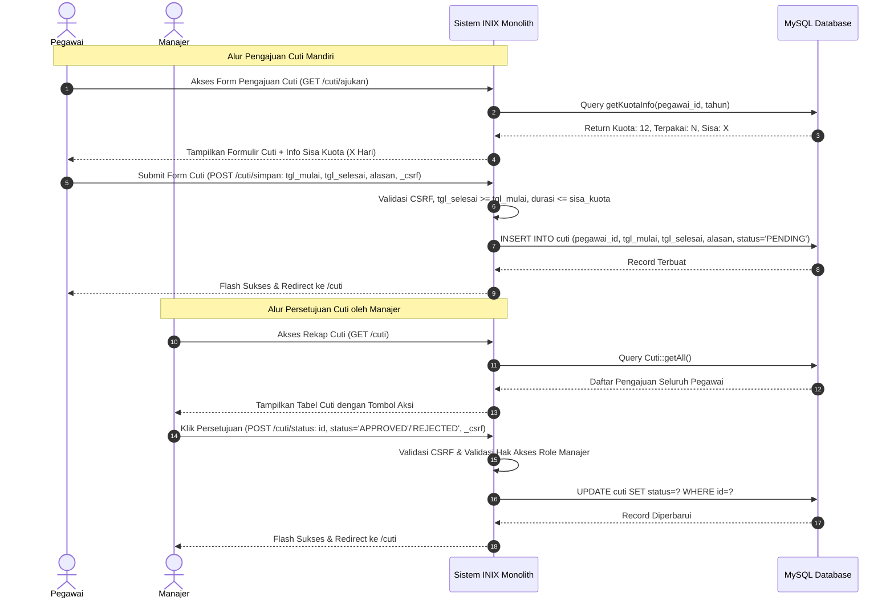

# FUNCTIONAL REQUIREMENTS DOCUMENT (FRD)
## Sistem Informasi Kepegawaian & Pelatihan PT INIX
### Versi Dokumen: 2.0 (AS-IS Reverse-Engineered Baseline)
### Tanggal: 18 November 2026

---

## 1. Document Overview
Dokumen Kebutuhan Fungsional (Functional Requirements Document / FRD) ini merepresentasikan kondisi aktual sistem aplikasi (*AS-IS*) Sistem Informasi Kepegawaian PT INIX hasil proses *system discovery* dan *reverse engineering* menyeluruh terhadap basis kode, skema basis data, dan konfigurasi lingkungan. Dokumen ini menjadi pedoman fungsional bagi Business Analyst, System Analyst, Software Developer, dan QA Automation Engineer.

---

## 2. Business Objectives
1. **Otomatisasi Administrasi Kepegawaian:** Menyediakan sistem sentralisasi pendataan pegawai internal PT INIX dengan pencatatan NIP yang terstruktur dan unik.
2. **Efisiensi Pengelolaan Hak Cuti:** Memfasilitasi proses pengajuan permohonan cuti secara mandiri oleh pegawai dengan perhitungan sisa kuota tahunan otomatis dan alur persetujuan terintegrasi oleh manajer.
3. **Penyediaan Platform Uji Kompetensi QA:** Menjadi platform web aplikasi monolitik yang andal, deterministik, dan kompatibel untuk pengujian perangkat lunak kurikulum pelatihan (Playwright, Postman, k6, OWASP ZAP, DBeaver, SonarQube).

---

## 3. Scope & Boundaries
### 3.1 Dalam Cakupan (In-Scope)
- Autentikasi berbasis sesi terproteksi dengan Role-Based Access Control (Admin, HR, Manajer, Pegawai).
- Pengelolaan master data profil pegawai (Create, Read, Update, Delete) dilengkapi fitur filter dan pencarian teks.
- Manajemen pengajuan permohonan cuti tahunan, validasi rentang tanggal, perhitungan kuota tahunan berjalan, serta persetujuan (*Approve/Reject*).
- Dashboard visualisasi ringkasan indikator personalia (jumlah pegawai aktif dan cuti pending).
- Endpoint probe pemantauan kesiapan sistem (`/health`).

### 3.2 Di Luar Cakupan (Out-of-Scope / Boundaries)
- Manajemen penggajian (payroll) dan perpajakan (PPh 21).
- Presensi harian berbasis biometrik / geolokasi GPS.
- Alur persetujuan cuti berjenjang multi-level (hanya 1 level oleh Manajer).
- Reset password mandiri via email SMTP (belum diimplementasikan pada AS-IS).

---

## 4. Stakeholders & User Roles (RBAC)

| Peran (Role) | Definisi & Karakteristik Aktor | Hak Akses Fungsional Utama | Bukti Kode (Source Evidence) |
|---|---|---|---|
| **Admin** | Administrator sistem personalia PT INIX dengan kewenangan tertinggi. | Akses penuh: Autentikasi, CRUD seluruh pegawai, penghapusan data pegawai, review cuti. | `includes/auth.php` (`require_role`), `PegawaiController.php::delete` |
| **HR** | Staf Human Resource Departemen Personalia. | Autentikasi, melihat daftar pegawai, menambah pegawai baru, mengubah profil pegawai, monitoring status cuti. | `PegawaiController.php::create, edit, store, update` |
| **Manajer** | Atasan fungsional / pimpinan unit kerja. | Autentikasi, melihat katalog data pegawai, meninjau permohonan cuti bawahan, melakukan persetujuan (`APPROVED`) atau penolakan (`REJECTED`). | `CutiController.php::updateStatus`, `schema.sql` (`role ENUM`) |
| **Pegawai** | Karyawan internal PT INIX. | Autentikasi portal mandiri, melihat profil, memantau sisa kuota cuti tahunan, mengajukan permohonan cuti baru. | `CutiController.php::create, store`, `app/Views/cuti/form.php` |

---

## 5. Business Process & Workflows

---

## 6. Functional Modules & Submodules
Sistem terbagi ke dalam 5 modul operasional:
1. **MOD-01: Monitoring & Infrastructure (`/health`)**
2. **MOD-02: Autentikasi & Sesi Kerja (`/login`, `/logout`)**
3. **MOD-03: Dashboard Analitik Kepegawaian (`/dashboard`)**
4. **MOD-04: Manajemen Data Pegawai (`/pegawai`, `/pegawai/tambah`, `/pegawai/edit`, `/pegawai/hapus`)**
5. **MOD-05: Manajemen Permohonan Cuti (`/cuti`, `/cuti/ajukan`, `/cuti/status`)**

---

## 7. Detailed Functional Requirements

### FR-001: Autentikasi Pengguna (Login)
- **Requirement ID:** `FR-001`
- **Requirement Name:** User Login Authentication
- **Description:** Sistem memvalidasi kredensial pengguna dan menginisialisasi sesi kerja aktif yang aman.
- **Actor:** Public / Pengguna Terdaftar
- **Preconditions:** Akun pengguna terdaftar di tabel `users` dengan `is_active = TRUE`.
- **Trigger:** Pengguna menekan tombol "Masuk ke Akun" pada formulir `/login`.
- **Main Flow:**
  1. Pengguna membuka `GET /login`.
  2. Pengguna mengisi `username` dan `password`, lalu submit formulir.
  3. Sistem memverifikasi validitas token CSRF.
  4. Sistem mencari record user berdasarkan `username`.
  5. Sistem memverifikasi hash password menggunakan `password_verify()`.
  6. Sistem memverifikasi flag `is_active == true`.
  7. Sistem meregenerasi ID sesi melalui `session_regenerate_id(true)`.
  8. Sistem menyimpan identitas user (`id`, `username`, `role`) ke dalam `$_SESSION['user']`.
  9. Sistem mengarahkan pengguna ke halaman `intended_url` atau `/dashboard`.
- **Alternative Flow:**
  - *Field Kosong:* Sistem membatalkan proses dan menampilkan flash error *"Username dan password wajib diisi."*
  - *Kredensial Salah:* Sistem membatalkan login dan menampilkan pesan *"Kredensial tidak valid."*
  - *Akun Nonaktif:* Sistem menampilkan pesan *"Akun Anda sedang dinonaktifkan. Silakan hubungi admin."*
  - *CSRF Invalid:* Sistem mengembalikan HTTP 403 Forbidden.
- **Business Rules:** BR-01 (Hash Bcrypt), BR-02 (Perlindungan eksistensi user).
- **Input/Output:** Input: `username`, `password`, `_csrf`. Output: HTTP 302 Redirect, PHP Session Cookie.
- **Postconditions:** Sesi terotentikasi aktif, hak akses role dikenali di seluruh controller.
- **Source Evidence:** `app/Controllers/AuthController.php::login` (line 19-48), `app/Models/User.php`.

---

### FR-002: Terminasi Sesi (Logout)
- **Requirement ID:** `FR-002`
- **Requirement Name:** User Session Logout
- **Description:** Mengakhiri sesi aktif pengguna secara aman dan menghapus cookie sesi klien.
- **Actor:** Authenticated User
- **Preconditions:** Pengguna berada dalam status terautentikasi.
- **Trigger:** Pengguna menekan tautan / tombol "Keluar".
- **Main Flow:**
  1. Pengguna mengirimkan request `GET` atau `POST` ke `/logout`.
  2. Sistem mengosongkan array `$_SESSION`.
  3. Sistem menghapus cookie `PHPSESSID` dengan menyetel expiration date lampau.
  4. Sistem mengeksekusi `session_destroy()`.
  5. Sistem mengarahkan pengguna kembali ke halaman `/login`.
- **Input/Output:** Input: HTTP Request. Output: HTTP 302 Redirect ke `/login`.
- **Source Evidence:** `app/Controllers/AuthController.php::logout` (line 50-53), `includes/auth.php::auth_logout`.

---

### FR-003: Dashboard Personalia
- **Requirement ID:** `FR-003`
- **Requirement Name:** Personnel Analytics Dashboard
- **Description:** Menampilkan overview statistik operasional personil dan permohonan cuti pending.
- **Actor:** Authenticated User (Semua Role)
- **Preconditions:** Pengguna telah berhasil login.
- **Trigger:** Pengguna mengakses `/dashboard`.
- **Main Flow:**
  1. Sistem memanggil `Pegawai::countAktif()` untuk menghitung pegawai dengan status `aktif`.
  2. Sistem memanggil `Cuti::countPending()` untuk menghitung permohonan cuti berstatus `PENDING`.
  3. Sistem merender view `app/Views/dashboard/index.php`.
- **Input/Output:** Input: Sesi pengguna. Output: Halaman HTML dashboard responsif.
- **Source Evidence:** `app/Controllers/DashboardController.php::index`, `app/Models/Pegawai.php`, `app/Models/Cuti.php`.

---

### FR-004: Pencarian dan Penyaringan Pegawai
- **Requirement ID:** `FR-004`
- **Requirement Name:** Employee Search and Filter Catalog
- **Description:** Menampilkan katalog data pegawai dengan kapabilitas pencarian nama/NIP serta filter status dan jabatan.
- **Actor:** Authenticated User
- **Preconditions:** Pengguna telah login.
- **Trigger:** Akses ke `GET /pegawai` dengan atau tanpa query parameter (`search`, `status`, `jabatan`).
- **Main Flow:**
  1. Sistem membaca query string `search`, `status`, `jabatan`.
  2. Sistem menyusun prepared statement dinamis dengan klausa `LIKE ?` dan `status = ?`.
  3. Sistem mengembalikan data gabungan pegawai beserta relasi username akun jika ada.
  4. Sistem merender view `app/Views/pegawai/index.php`.
- **Source Evidence:** `app/Controllers/PegawaiController.php::index`, `app/Models/Pegawai.php::getAll`.

---

### FR-005: Pendaftaran Pegawai Baru
- **Requirement ID:** `FR-005`
- **Requirement Name:** Add New Employee Record
- **Description:** Menambahkan data identitas pegawai baru ke dalam basis data.
- **Actor:** HR, Admin
- **Preconditions:** Pengguna memiliki role `hr` atau `admin`.
- **Trigger:** Submit formulir pada `POST /pegawai/simpan`.
- **Main Flow:**
  1. Sistem memeriksa otorisasi peran via `require_role('hr', 'admin')`.
  2. Sistem memvalidasi CSRF token.
  3. Sistem memastikan field `nip`, `nama_lengkap`, dan `jabatan` tidak kosong.
  4. Sistem mengecek keunikan NIP via `Pegawai::getByNip($nip)`. Jika duplikat, sistem menampilkan flash error dan kembali ke form.
  5. Sistem menyimpan entitas pegawai dengan nilai default kuota cuti 12 hari.
  6. Sistem memberikan flash pesan sukses dan mengarahkan ke `/pegawai`.
- **Source Evidence:** `app/Controllers/PegawaiController.php::store` (line 39-67), `app/Models/Pegawai.php::create`.

---

### FR-006: Pembaruan Data Pegawai
- **Requirement ID:** `FR-006`
- **Requirement Name:** Update Existing Employee Record
- **Description:** Memperbarui data pegawai yang telah terdaftar.
- **Actor:** HR, Admin
- **Trigger:** Submit formulir pada `POST /pegawai/update`.
- **Main Flow:**
  1. Sistem memvalidasi role `hr` atau `admin` dan token CSRF.
  2. Sistem memeriksa validitas ID pegawai (`id > 0`).
  3. Sistem memeriksa bentrok NIP terhadap record pegawai lain (`existing['id'] !== $id`).
  4. Sistem memperbarui atribut NIP, Nama Lengkap, Jabatan, dan Status.
  5. Sistem melakukan redirect ke `/pegawai` dengan pesan sukses.
- **Source Evidence:** `app/Controllers/PegawaiController.php::update` (line 86-121).

---

### FR-007: Penghapusan Data Pegawai
- **Requirement ID:** `FR-007`
- **Requirement Name:** Delete Employee Record
- **Description:** Menghapus data pegawai secara permanen dari sistem.
- **Actor:** Admin (Khusus Role Admin)
- **Trigger:** Submit request `POST /pegawai/hapus`.
- **Main Flow:**
  1. Sistem memverifikasi bahwa peran pengguna adalah `admin`. Jika bukan, sistem menolak dengan HTTP 403.
  2. Sistem memverifikasi token CSRF.
  3. Sistem mengeksekusi penghapusan pada `Pegawai::delete($id)`. Riwayat cuti terkait terhapus otomatis melalui mekanisme database foreign key `ON DELETE CASCADE`.
  4. Sistem redirect ke `/pegawai` dengan pesan sukses.
- **Source Evidence:** `app/Controllers/PegawaiController.php::delete` (line 123-136).

---

### FR-008: Monitoring dan Rekap Cuti
- **Requirement ID:** `FR-008`
- **Requirement Name:** Leave Requests Overview and Quota Inspection
- **Description:** Menampilkan daftar pengajuan cuti dan kalkulasi sisa kuota pegawai.
- **Actor:** Authenticated User
- **Main Flow:**
  - Jika peran adalah `pegawai`, sistem mengambil ID pegawai terkait dan menampilkan riwayat permohonan miliknya beserta widget ringkasan sisa kuota tahunan (`Cuti::getKuotaInfo`).
  - Jika peran adalah `manajer`, `hr`, atau `admin`, sistem menampilkan tabel rekapitulasi seluruh pengajuan cuti semua pegawai.
- **Source Evidence:** `app/Controllers/CutiController.php::index` (line 9-35), `app/Models/Cuti.php::getKuotaInfo`.

---

### FR-009: Pengajuan Permohonan Cuti
- **Requirement ID:** `FR-009`
- **Requirement Name:** Submit Leave Request
- **Description:** Pegawai mengajukan permohonan cuti baru dengan validasi kuota tahunan.
- **Actor:** Pegawai
- **Trigger:** Submit formulir pada `POST /cuti/simpan`.
- **Main Flow:**
  1. Sistem memvalidasi role `pegawai` dan CSRF token.
  2. Sistem memastikan tersedianya data profil pegawai yang terhubung dengan akun user.
  3. Sistem memvalidasi field tanggal mulai, tanggal selesai, dan alasan tidak kosong.
  4. Sistem memvalidasi aturan tanggal: `tgl_selesai >= tgl_mulai`.
  5. Sistem menghitung durasi hari: `diff->days + 1`.
  6. Sistem memeriksa apakah `durasi <= sisa_kuota`. Jika melebihi kuota, sistem membatalkan dan menampilkan flash error.
  7. Sistem menyimpan pengajuan cuti dengan status default `PENDING`.
  8. Sistem redirect ke `/cuti` dengan flash sukses.
- **Source Evidence:** `app/Controllers/CutiController.php::store` (line 54-100), `app/Models/Cuti.php::create`.

---

### FR-010: Persetujuan / Penolakan Cuti
- **Requirement ID:** `FR-010`
- **Requirement Name:** Leave Approval and Rejection
- **Description:** Manajer memutuskan persetujuan atau penolakan pengajuan cuti.
- **Actor:** Manajer
- **Trigger:** Submit aksi pada `POST /cuti/status`.
- **Main Flow:**
  1. Sistem memvalidasi role `manajer` dan token CSRF.
  2. Sistem memvalidasi bahwa payload status bernilai `APPROVED` atau `REJECTED`.
  3. Sistem memperbarui status record cuti pada tabel `cuti`.
  4. Jika status disetujui (`APPROVED`), sisa kuota pegawai pada tahun bersangkutan otomatis berkurang saat dihitung ulang oleh `getKuotaInfo`.
  5. Sistem redirect ke `/cuti` dengan flash sukses.
- **Source Evidence:** `app/Controllers/CutiController.php::updateStatus` (line 102-117), `app/Models/Cuti.php::updateStatus`.

---

### FR-011: Health Check Endpoint
- **Requirement ID:** `FR-011`
- **Requirement Name:** System Health Probe
- **Description:** Menyediakan status ketersediaan aplikasi bagi Docker, kubernetes, atau CI/CD monitoring.
- **Actor:** Public / DevOps Automated Agent
- **Trigger:** Request `GET /health`.
- **Main Flow:** Sistem merespon dengan status code HTTP 200 dan payload JSON: `{"status": "ok", "app": "PT INIX Monolith", "time": "..."}`.
- **Source Evidence:** `public/index.php` (line 31-39).

---

## 8. Business Rules (Aturan Bisnis Sistem)

- **BR-01 (Kredensial Aman):** Password wajib di-hash menggunakan algoritma Bcrypt via `password_hash()`. Tidak diizinkan menyimpan teks mentah (*plaintext*).
- **BR-02 (Keunikan NIP):** NIP pegawai harus unik di seluruh sistem.
- **BR-03 (Kuota Dasar Cuti):** Kuota cuti tahunan pegawai ditetapkan secara default sebesar 12 hari kalender per tahun.
- **BR-04 (Integritas Tanggal Cuti):** Tanggal selesai cuti tidak boleh lebih awal dari tanggal mulai (`tgl_selesai >= tgl_mulai`).
- **BR-05 (Batas Kuota):** Total hari pengajuan cuti yang diajukan tidak boleh melampaui sisa kuota tahun berjalan yang belum terpakai.
- **BR-06 (Kewenangan Approval):** Hanya peran `manajer` yang berwenang mengubah status pengajuan cuti menjadi `APPROVED` atau `REJECTED`.
- **BR-07 (Kewenangan Deletion):** Hanya peran `admin` yang diizinkan menghapus record data pegawai.
- **BR-08 (Proteksi Mutasi Data):** Seluruh request dengan metode `POST` wajib melewati verifikasi kecocokan token CSRF session.
