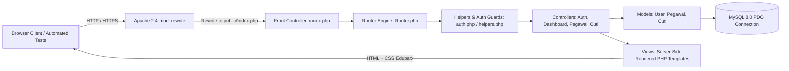

# SOFTWARE REQUIREMENTS SPECIFICATION (SRS)
## Sistem Informasi Kepegawaian & Pelatihan PT INIX
### Mengacu pada Standar ISO/IEC/IEEE 29148 & IEEE Std 830-1998
### Versi Dokumen: 2.0 (AS-IS Reverse-Engineered Baseline)
### Tanggal: 18 November 2026

---

## 1. Pendahuluan (Introduction)

### 1.1 Tujuan (Purpose)
Dokumen Spesifikasi Kebutuhan Perangkat Lunak (Software Requirements Specification / SRS) ini merinci spesifikasi teknis, arsitektural, antarmuka eksternal, kebutuhan data, dan kriteria penerimaan sistem aplikasi Kepegawaian PT INIX pada kondisi aktual (*AS-IS*). Dokumen ini ditujukan bagi Software Architect, Backend/Frontend Developer, QA Engineer, dan System Administrator.

### 1.2 Cakupan Produk (Scope)
Sistem Informasi Kepegawaian PT INIX adalah sistem monolitik berbasis web yang menangani:
- Manajemen akun dan autentikasi berbasis sesi dengan kontrol hak akses (RBAC).
- Pengelolaan siklus hidup data pegawai (CRUD).
- Pengelolaan siklus hidup pengajuan dan persetujuan cuti tahunan pegawai.
- Dashboard metrik operasional personalia.
- Antarmuka pengujian otomatis terstandarisasi atribut `data-testid`.

### 1.3 Definisi, Akronim, dan Singkatan
- **SRS:** Software Requirements Specification
- **FRD:** Functional Requirements Document
- **RBAC:** Role-Based Access Control
- **MVC:** Model-View-Controller
- **SSR:** Server-Side Rendering
- **PDO:** PHP Data Objects
- **CSRF:** Cross-Site Request Forgery
- **XSS:** Cross-Site Scripting
- **NIP:** Nomor Induk Pegawai
- **TBD:** To Be Determined

### 1.4 Referensi Standar
- ISO/IEC/IEEE 29148:2018 *Systems and software engineering — Life cycle processes — Requirements engineering*.
- IEEE Std 830-1998 *IEEE Recommended Practice for Software Requirements Specifications*.

---

## 2. Deskripsi Keseluruhan Sistem (Overall Description)

### 2.1 Perspektif Produk
Sistem beroperasi sebagai aplikasi monolitik mandiri (*self-contained monolithic web application*) yang diwadahi dalam kontainerisasi Docker. Aplikasi tidak memiliki ketergantungan API pihak ketiga eksternal untuk fungsi intinya.

### 2.2 Karakteristik Pengguna & Persona (RBAC)
Sistem membatasi hak akses berdasarkan 4 peran pengguna yang tersimpan dalam tipe data ENUM pada tabel basis data `users`:
1. **Admin:** Memiliki wewenang tertinggi untuk mengelola seluruh data pegawai termasuk hak khusus menghapus (*delete*) data personil.
2. **HR:** Staf personalia yang berwenang menambah dan memperbarui data profil pegawai serta memantau rekap cuti.
3. **Manajer:** Pimpinan departemen yang memiliki otoritas eksklusif untuk menyetujui (*Approve*) atau menolak (*Reject*) permohonan cuti.
4. **Pegawai:** Karyawan internal yang berhak melihat sisa kuota cuti tahunan miliknya serta membuat pengajuan cuti baru.

### 2.3 Lingkungan Operasional (Operating Environment)
- **Web Server:** Apache 2.4 dengan modul `mod_rewrite` aktif.
- **PHP Engine:** PHP 8.2 (ekstensi `pdo` dan `pdo_mysql` terinstal).
- **Database Engine:** MySQL 8.0 Server (InnoDB Storage Engine, Character Set `utf8mb4`).
- **Orkestrasi:** Docker Compose 2.x multi-container network.
- **Klien Browser:** Google Chrome, Mozilla Firefox, Microsoft Edge, Safari.

---

## 3. Arsitektur Perangkat Lunak (System Architecture)

Aplikasi dibangun dengan pola arsitektur **Front Controller + Model-View-Controller (MVC) Monolitik**:

- **Front Controller (`public/index.php`):** Menerima seluruh lalu lintas request HTTP dan mendelegasikannya ke routing engine.
- **Routing Engine (`includes/Router.php`):** Melakukan resolusi URL path terhadap controller/handler method yang sesuai.
- **Controllers Layer (`app/Controllers/`):** Mengelola logika presentasi, validasi input, dan koordinasi antar layer.
- **Models Layer (`app/Models/`):** Menyediakan enkapsulasi kueri basis data dengan prepared statements PDO.
- **Views Layer (`app/Views/`):** Menghasilkan dokumen HTML terstruktur menggunakan tema Eduparx Design System.

---

## 4. Kebutuhan Fungsional Sistem (Functional Requirements)

Rincian kebutuhan fungsional mengacu secara konsisten pada Requirement Traceability Matrix:

- **FR-001 (Autentikasi Login):** Sistem memvalidasi kredensial pengguna, memeriksa status aktif (`is_active`), memperbarui session ID untuk mencegah session fixation, dan menyimpan data sesi login.
- **FR-002 (Feedback Kesalahan Login):** Sistem menampilkan alert flash error yang jelas tanpa membocorkan eksistensi user di database.
- **FR-003 (Logout Sesi):** Sistem membersihkan array `$_SESSION`, mematikan cookie klien, dan menghancurkan sesi di server.
- **FR-004 (Dashboard Personalia):** Sistem menyajikan metrik statistik dinamis jumlah pegawai aktif dan jumlah cuti pending.
- **FR-005 (Katalog & Pencarian Pegawai):** Sistem menampilkan daftar pegawai dengan pencarian teks bebas (nama/NIP) dan filter kategori status/jabatan.
- **FR-006 (Entri Pegawai Baru):** Sistem memvalidasi field wajib serta keunikan NIP sebelum menyisipkan data pegawai baru.
- **FR-007 (Pembaruan Pegawai):** Sistem mengizinkan perubahan data pegawai dan mencegah bentrok NIP dengan record lain.
- **FR-008 (Penghapusan Pegawai):** Khusus role Admin, sistem dapat menghapus data pegawai dengan penghapusan cascading permohonan cuti.
- **FR-009 (Monitoring & Sisa Kuota Cuti):** Sistem menghitung sisa kuota cuti tahunan berjalan (`kuota_tahunan - cuti_approved_tahun_berjalan`).
- **FR-010 (Pengajuan Cuti):** Pegawai dapat mengajukan cuti dengan validasi tanggal (`tgl_selesai >= tgl_mulai`) dan batasan kuota.
- **FR-011 (Persetujuan Cuti):** Manajer dapat memperbarui status pengajuan cuti menjadi `APPROVED` atau `REJECTED`.
- **FR-012 (Health Check Monitoring):** Sistem menyediakan endpoint `GET /health` yang mengembalikan status JSON kesehatan aplikasi.

---

## 5. Kebutuhan Antarmuka Eksternal (External Interface Requirements)

### 5.1 Antarmuka Pengguna (User Interface)
- Antarmuka web dibangun bertema **Eduparx Training Catalog** dengan gradien warna biru khas (`#1b2a4e` s.d. `#204ecf`).
- Seluruh elemen formulir dan tabel data dilengkapi atribut **`data-testid`** standar pengujian otomasi:
  - Form Login: `input-username`, `input-password`, `btn-login`, `error-message`.
  - Pegawai: `pegawai-table`, `search-pegawai`, `btn-tambah`, `btn-simpan`, `btn-edit-{id}`, `btn-delete-{id}`.
  - Cuti: `cuti-table`, `btn-ajukan-cuti`, `sisa-kuota-cuti`, `btn-approve-{id}`, `btn-reject-{id}`.
- Komponen alert flash: `success-message` dan `form-error`.

### 5.2 Antarmuka Perangkat Keras (Hardware Interface)
- Persyaratan minimum server: 1 vCPU, RAM 1 GB, Disk Space 2 GB (untuk container Docker PHP & MySQL).

### 5.3 Antarmuka Perangkat Lunak (Software Interface)
- PHP Data Objects (PDO) terhubung ke MySQL 8.0 melalui socket TCP pada port `3306`.
- Server HTTP Apache terhubung ke port host `8000`.

### 5.4 Antarmuka Komunikasi (Communications Interface)
- Protokol transfer: HTTP/1.1 (pengembangan lokal) / HTTPS (lingkungan produksi).
- Format respon data: HTML5 (dokumen web) dan JSON (endpoint `/health`).

---

## 6. Kebutuhan Non-Fungsional (Non-Functional Requirements)

| ID | Parameter Kualitas | Spesifikasi & Metrik Keberhasilan | Implementasi Aktual |
|---|---|---|---|
| **NFR-001** | **Performance** | Response time server-side rendering ≤ 500 ms P95 pada beban operasional standar. | PHP 8.2 OPcache & indexed MySQL queries. |
| **NFR-002** | **Security (Injection)** | Sistem kebal terhadap serangan SQL Injection dan XSS. | PDO prepared statements (`EMULATE_PREPARES=false`) & sanitasi `e()` via `htmlspecialchars(..., ENT_QUOTES)`. |
| **NFR-003** | **Security (CSRF)** | Seluruh transaksi form POST dilindungi token sesi anti-CSRF. | Fungsi `csrf_verify()` memvalidasi token via `hash_equals()`. |
| **NFR-004** | **Security (Auth)** | Penyimpanan password terenkripsi; penanganan sesi aman. | Algoritma hashing Bcrypt `PASSWORD_DEFAULT` & `session_regenerate_id(true)`. |
| **NFR-005** | **Reliability** | Basis data menjamin ACID compliance dan integritas referensial. | MySQL InnoDB Foreign Key constraints (`CASCADE` & `SET NULL`). |
| **NFR-006** | **Maintainability** | Kode bersih, terstruktur modular MVC, dan mudah dibaca tanpa framework eksternal. | Pemisahan bersih direktori Controller, Model, View, Config, dan Helpers. |
| **NFR-007** | **Compatibility** | Antarmuka responsif dan tampil konsisten pada browser modern. | Pure CSS Flexbox & CSS Grid, font Inter, viewport metadata responsif. |
| **NFR-008** | **Testability** | 100% alur fungsional utama dapat diuji otomatis melalui selector yang stabil. | Seluruh form control, tabel, tombol, dan pesan memiliki atribut `data-testid`. |

---

## 7. Batasan Sistem (System Constraints) & Catatan Desain
1. **Arsitektur Monolitik Murni:** Tidak menggunakan arsitektur microservices atau SPA frontend framework (React/Vue/Angular) untuk mempertahankan kesederhanaan deployment dan token efficiency.
2. **Karakteristik Pengujian Keamanan (Security Training Ready):** Sistem sengaja mempertahankan header default server (`X-Powered-By: PHP/8.2`) dan tidak mengaktifkan rate-limiting login agar siswa pelatihan dapat mengeksplorasi temuan vulnerabilitas OWASP ZAP dan pengujian beban k6.
3. **Ketergantungan Sesi Server:** Sistem bergantung pada file-based session PHP bawaan; untuk horizontal scaling multi-server di masa depan diperlukan session storage terpusat (e.g. Redis).

---

## 8. Kriteria Penerimaan Sistem (System Acceptance Criteria)

| Skenario Pengujian | Kriteria Penerimaan | Verifikasi |
|---|---|---|
| **Otentikasi Login** | Login dengan kredensial valid berhasil membuat sesi dan redirect ke dashboard dalam waktu < 1 detik. | Lolos uji `test/login_positive_test.spec.ts` |
| **Pencegahan Login Invalid** | Input password salah atau username kosong memunculkan alert error yang sesuai dan tidak mengizinkan akses ke halaman internal. | Lolos uji `test/login_negative_test.spec.ts` |
| **Integritas NIP Pegawai** | Pendaftaran pegawai dengan NIP yang sudah ada ditolak dengan pesan kesalahan yang informatif. | Verifikasi controller `PegawaiController::store` |
| **Kalkulasi Sisa Cuti** | Sisa kuota cuti tahunan pegawai berkurang secara otomatis dan akurat sesuai jumlah hari cuti berstatus `APPROVED`. | Verifikasi method `Cuti::getKuotaInfo` |
| **Proteksi Hak Akses (RBAC)** | User non-admin yang mencoba mengakses penghapusan pegawai atau user non-manajer yang mencoba approval cuti ditolak dengan respon HTTP 403 Forbidden. | Verifikasi `require_role()` middleware |
| **Proteksi CSRF** | Request mutasi POST tanpa parameter `_csrf` yang valid dibatalkan seketika dengan respon HTTP 403. | Verifikasi fungsi `csrf_verify()` |
