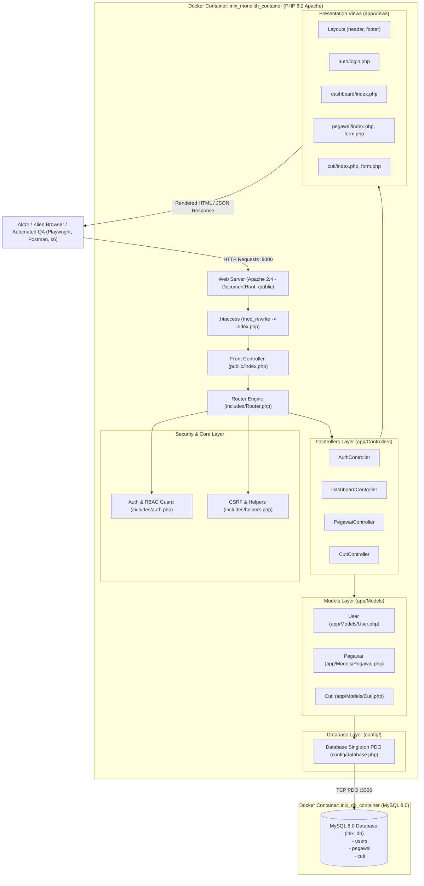

# SYSTEM ARCHITECTURE DOCUMENTATION
## Aplikasi Kepegawaian & Pelatihan PT INIX (Monolitik PHP Native + MySQL)

---

### 1. Ringkasan Eksekutif & Karakteristik Arsitektur
Sistem Informasi Kepegawaian PT INIX diimplementasikan menggunakan **Arsitektur Monolitik Klasik Berbasis MVC (Model-View-Controller) dengan Pola Front-Controller**. Seluruh alur kerja web (routing, autentikasi sesi, orkestrasi kontroler, model data, dan antarmuka HTML Server-Side Rendering) berada dalam satu basis kode PHP Native tanpa framework pihak ketiga.

- **Pola Arsitektur:** Front Controller + MVC (Model-View-Controller) Server-Side Rendered (SSR).
- **Runtime Backend:** PHP 8.2 running on Apache 2.4 (`mod_rewrite` enabled).
- **Persistence Layer:** Relational Database MySQL 8.0 InnoDB (UTF-8 Unicode `utf8mb4`).
- **Akses Basis Data:** PHP Data Objects (PDO) dengan mode *Prepared Statements* penuh.
- **Presentasi & UI:** Semantic HTML5, Server-Side Rendered PHP Views, Pure CSS (Eduparx Design System), Vanilla ES6 JavaScript.
- **Orkestrasi Deployment:** Docker Compose multi-container (`app` + `db`).

---

### 2. Diagram Arsitektur Tingkat Tinggi (High-Level Architecture)

---

### 3. Komponen Arsitektur Utama

| Layer / Komponen | File / Direktori Sumber | Deskripsi & Tanggung Jawab |
|---|---|---|
| **Entry Point (Front Controller)** | `public/index.php` | Menginisialisasi sesi PHP, mendefinisikan routing tabel sistem, mengimpor seluruh dependensi, dan melakukan dispatching request. |
| **URL Rewriting** | `public/.htaccess`, `Dockerfile` | Mengarahkan seluruh request HTTP ke `index.php` melalui modul Apache `mod_rewrite`. |
| **Routing Dispatcher** | `includes/Router.php` | Mencocokkan request URI dan method HTTP (GET/POST) terhadap handler (Closure atau Controller action). Menyediakan fallback HTTP 404 Eduparx kustom. |
| **Authentication & RBAC** | `includes/auth.php` | Menyimpan sesi login user, fungsi pengujian hak akses berbasis peran (`require_role()`), regenerasi ID sesi saat login, dan penghapusan cookie sesi saat logout. |
| **Security & Helpers** | `includes/helpers.php` | Proteksi XSS (`e()`), pembuatan dan validasi CSRF token (`csrf_token()`, `csrf_verify()`), pengelolaan session flash messages, dan mekanisme HTTP redirect. |
| **Controllers** | `app/Controllers/` | Menerima payload request, melakukan validasi logika alur bisnis, memanggil model, dan merender view template terkait. |
| **Models** | `app/Models/` | Mengabstraksi kueri basis data menggunakan PDO prepared statements untuk entitas `User`, `Pegawai`, dan `Cuti`. |
| **Views / UI** | `app/Views/` | Berisi template PHP modular berbasis Server-Side Rendering bertema Eduparx dengan integrasi atribut `data-testid` untuk memfasilitasi E2E testing. |
| **Database Connector** | `config/database.php` | Pola desain *Singleton* untuk koneksi database PDO MySQL berbasis variabel lingkungan (`.env`). |
| **Database Persistence** | `database/schema.sql`, `database/seed.php` | DDL basis data MySQL dan script seeding CLI untuk kebutuhan otomatisasi pengujian. |

---

### 4. Alur Pemrosesan Request (Request Flow Lifecycle)

1. **Inbound HTTP Request:** Klien mengirimkan request ke `http://localhost:8000/{uri}`.
2. **Web Server Interception:** Apache menerima request pada port 80 (dimapping dari port 8000). Jika file statis tidak ditemukan secara fisik, `.htaccess` mengarahkan request ke `public/index.php`.
3. **Session Initialization & Routing:** `index.php` memastikan sesi aktif via `session_start()`, mendaftarkan mapping endpoint ke objek `Router`, lalu memanggil `$router->dispatch()`.
4. **Endpoint Resolution:** Objek `Router` menormalisasi URI, memeriksa HTTP Method, dan mengeksekusi handler controller terkait.
5. **Security & Authorization Interception:**
   - Metode `require_auth()` memvalidasi keberadaan `$_SESSION['user']`.
   - Metode `require_role(...)` memastikan role user (`admin`, `hr`, `manajer`, `pegawai`) memiliki wewenang.
   - Metode `csrf_verify()` memverifikasi integritas token CSRF pada seluruh transaksi mutasi POST.
6. **Business Logic Execution & Data Access:** Controller berinteraksi dengan class Model (`User`, `Pegawai`, `Cuti`) yang mengeksekusi prepared statement PDO ke container MySQL.
7. **Response Rendering:** Controller menyusun data model dan mengimpor view PHP terkait (`header.php` -> `content view` -> `footer.php`) untuk menghasilkan HTML akhir yang dikirimkan kembali ke klien.

---

### 5. Konfigurasi Deployment & Infrastruktur

- **Docker Containerization:**
  - `inix_monolith_container`: Didasarkan pada `php:8.2-apache`, mapping port host `8000:80`, volume bind-mount kode ke `/var/www/html`.
  - `inix_db_container`: Didasarkan pada image `mysql:8.0`, mapping port host `3306:3306`, persistent storage volume `mysql_data`, dilengkapi docker healthcheck via `mysqladmin ping`.
- **Environment Variables:**
  - `DB_HOST`: Host target (`db` dalam docker-compose, `localhost` jika dijalankan native).
  - `DB_PORT`: `3306`
  - `DB_NAME`: `inix_db`
  - `DB_USER`: `root`
  - `DB_PASSWORD`: `rootpassword`
  - `APP_ENV`: `development`
